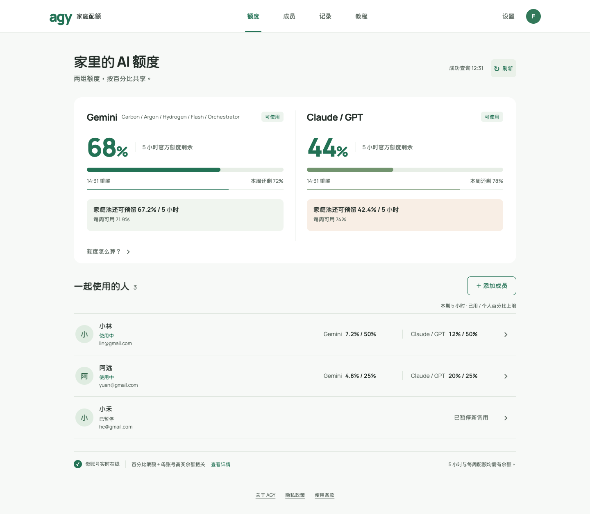
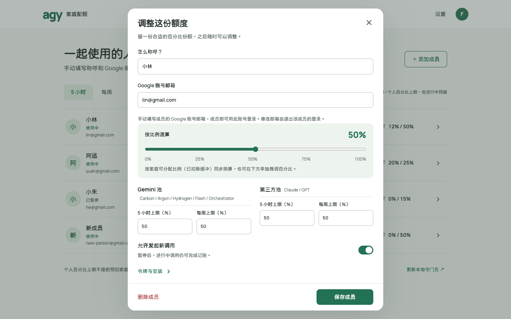
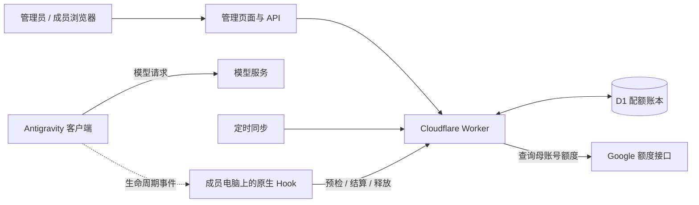

# AGY 家庭配额

让家里的 Antigravity 额度按需分配，每个人都知道自己还能用多少。

双模型池 · 百分比分配 · Google 登录 · 原生 Hooks · Cloudflare Workers + D1

[](https://deploy.workers.cloudflare.com/?url=https%3A%2F%2Fgithub.com%2FGrinZero%2Fagy-manager)

[快速开始](#快速开始) · [成员接入](#成员接入) · [界面预览](#界面预览) · [工作原理](#工作原理) · [文档](#文档)

AGY 是为互信家庭成员准备的 Antigravity 额度管理器。管理员连接母账号，将 Gemini 与 Claude / GPT 两组额度按百分比分给成员；成员在自己的电脑安装守门员，每次调用前检查余额，完成后自动记账。管理页面、API 和数据库部署在同一个 Cloudflare 项目中，无需常驻服务器。

这是依赖成员保留客户端 Hook 的软限制。Google 家庭组邀请和本站成员添加需要分别完成。

## 可以做什么

| 能力 | 你可以用它做什么 |
| --- | --- |
| 📊 看清家庭额度 | 同时查看 Gemini、Claude / GPT 两个池的官方剩余额度、5 小时与每周重置时间，以及进行中的预留。 |
| 🎚️ 按百分比分配 | 用比例滑条分配个人份额，也可单独调整每个池和时间窗口的上限，设置家庭预算与安全缓冲。 |
| 🔐 各自登录 | 管理员管理成员、策略与母账号；成员用绑定的 Google 邮箱查看自己的用量、流水和安装令牌。 |
| 🛡️ 调用前守门 | 通过原生 `PreInvocation`、`PostInvocation`、`Stop` Hooks 预留、结算和释放额度，余额不足时暂停新调用。 |
| 🔄 自动对账 | 活跃时每分钟、空闲时每 5 分钟同步母账号余额，结合调用消耗自动校准估算比例。 |
| 💻 跨平台安装 | 支持 macOS、Linux 和 Windows，合并已有 Hook 配置并先备份；安装完成前执行 Hook 自检。 |
| ☁️ 自行托管 | Worker 提供页面和接口，D1 保存账本；成员模型请求仍由 Antigravity 直接发送。 |

## 快速开始

### 1. 部署到 Cloudflare

点击顶部 **Deploy to Cloudflare** 按钮，登录 Cloudflare 并连接 GitHub。部署向导会将仓库复制到你的账号，创建 Worker 和 D1 数据库，并配置后续构建部署。

在向导中填写以下 Secret：

| Secret | 填写内容 |
| --- | --- |
| `ADMIN_GOOGLE_EMAIL` | 作为管理员的母账号 Google 邮箱。首次登录后会绑定该账号的固定身份。 |
| `ACCOUNT_ENCRYPTION_KEY` | 随机生成的 **64 位小写十六进制密钥**，用于加密母账号凭据。请备份到密码管理器，后续部署继续使用同一个值。 |

在本机终端运行以下命令生成密钥，然后将输出填入向导：

```sh
node -e "console.log(require('node:crypto').randomBytes(32).toString('hex'))"
```

保留默认构建与部署命令：`npm run build`、`npm run deploy`。部署脚本会先通过 `DB` 绑定应用数据库迁移，再发布 Worker 和管理页；在向导中修改数据库名称也能使用。

日常 Google 登录只需要上述两项配置。需要备用令牌登录或管理 API 时，可另行设置至少 32 字符的随机 `ADMIN_TOKEN`，见[部署与账号配置](docs/deployment.md)。按钮的资源创建流程见 [Cloudflare 官方说明](https://developers.cloudflare.com/workers/platform/deploy-buttons/)。

<details>
<summary>使用命令行部署</summary>

需要 Node.js 22.12+（推荐 24 LTS）和 Cloudflare 账号。以下步骤适用于首次克隆；已有部署请保留原配置与密钥。

```sh
git clone https://github.com/GrinZero/agy-manager.git
cd agy-manager
npm ci
cp wrangler.example.json wrangler.json
npx wrangler login
npm run setup:cloud
npx wrangler secret put ADMIN_GOOGLE_EMAIL
node scripts/setup-account-key.mjs --production
npm run deploy
```

`setup:cloud` 创建 D1 并将 ID 写入本机 `wrangler.json`。通过按钮创建的仓库已经绑定 D1，可直接使用其 `wrangler.jsonc`，无需再次复制示例或创建数据库。多账号、已有数据库与密钥备份说明见[部署文档](docs/deployment.md)。

</details>

### 2. 登录并连接母账号

1. 打开部署输出的 `https://…workers.dev` 地址，点击「使用 Google 账号登录」，选择配置的母账号。
2. 默认使用桌面 OAuth 授权。授权后浏览器会跳转到 `http://localhost:50987/oauth-callback`；即使显示无法访问，也请复制地址栏中的**完整地址**，回到原后台粘贴完成连接。无需启动本地服务器，不要分享该地址。
3. 确认首页显示母账号的两组官方额度。`GET /health` 可检查服务与数据库连通性。

首次部署无需自行申请 Google OAuth 客户端。自有客户端的访问资格、自动回调与授权排错见[母账号连接说明](docs/deployment.md#云端母账号与真实额度对账)。

### 3. 添加成员并分配份额

在「成员」页点击「添加成员」，填写称呼、Google 账号邮箱和百分比限额。例如：A 分配 50%、B 分配 25%、C 分配 25%。份额是个人使用上限，设置时不会提前扣减家庭额度。

成员使用绑定邮箱登录同一个地址后，即可查看自己的额度和流水，并在「教程」生成安装令牌。Google 家庭组请在 Google 侧另行邀请，本站不会自动读取或同步家庭成员。

## 成员接入

成员电脑需要 Node.js。推荐打开「教程」，生成令牌后点击「复制安装提示词给我的 AI」，交给能执行本机命令的 AI 助手完成安装与配置检查。也可使用页面按 macOS / Linux、Windows 分别生成的终端命令。

如果已经克隆本仓库，可直接运行：

```sh
node public/client/install.mjs --url https://YOUR-WORKER.workers.dev
```

将地址替换为自己的部署地址，按提示粘贴成员令牌；输入会隐藏。安装器会备份并合并 `~/.gemini/config/hooks.json`，保留其他 Hooks。看到「Hook 自检通过」后，重启 Antigravity 客户端，并手动将桌面端 / IDE 的 **AI Credit Overages → Never**。

「手册」（`/#manual`）会按系统生成安装、更新、代理设置和 `/health` 测速命令。直连不稳定时，可配置仅供守门员使用的 HTTP 代理；`--upgrade` 保留代理，`--upgrade --no-proxy` 移除代理。

成员令牌只显示一次。重置后旧令牌立即失效，需要在使用该令牌的所有电脑上重新安装。安装、升级、卸载和 Windows 排错见[成员接入指南](docs/member-guide.md)。

## 界面预览

以下为本地 UI 验收使用示例数据生成的实际界面截图。

| 家庭额度总览 | 成员份额调整 |
| --- | --- |
| [](docs/images/home-desktop.png) | [](docs/images/member-edit-desktop.png) |

## 工作原理



每次调用先同时检查个人上限、家庭上限和母账号真实余额，预留额度；完成后按可用的 Token 用量统计结算，并用官方余额变化校准估算比例。流水按调用身份去重，临时断网后的完成记录会留在本机，等待后续 Hook 补记。5 小时和每周账期跟随官方重置时间。

母账号未连接、授权失效，或连续超过 15 分钟无法同步时，会暂停新调用。算法、模型权重、重试和一致性细节见[配额模型](docs/quota-model.md)。

## 使用前了解

- **适合互信成员。** 删除或修改本机 Hook 可以绕过限制；本项目无法提供 Google 官方的成员配额隔离。
- **消耗按模型权重与用量估算。** 自动校准有助于接近官方消耗，但无法保证官方池永不触发限流，也不能保证所有错误和取消都不记账。
- **额度查询依赖非公开接口。** 默认 OAuth 应用身份及上游接口发生变化时，可能需要更新项目或重新授权。
- **保护部署凭据。** 母账号凭据加密存入自己的 D1；管理员令牌与加密密钥不要交给成员。客户端只上报记账所需的模型、调用标识、Token 计数和状态，不上传提示词、工作目录或转录内容。

完整行为与限制见[能力边界](docs/quota-model.md#能力边界)。

## 本地开发

需要 Node.js 22.12+（推荐 24 LTS）。首次克隆后运行：

```sh
npm ci
npm run dev
```

打开 <http://127.0.0.1:8787>。启动前会自动生成 `.dev.vars` 中的本地密钥并应用本地数据库迁移。设置 `ADMIN_GOOGLE_EMAIL` 后使用 Google 登录，或通过 `.dev.vars` 中的 `ADMIN_TOKEN` 进入备用登录入口。

```sh
npm run check
```

开发与 UI 验收命令见[贡献指南](CONTRIBUTING.md)。

## 文档

| 主题 | 入口 |
| --- | --- |
| Cloudflare 部署、Google OAuth、密钥备份与 fork 配置 | [部署与账号配置](docs/deployment.md) |
| 成员登录、客户端安装、升级与卸载 | [成员接入指南](docs/member-guide.md) |
| 双池权重、预留结算、自动校准与一致性 | [配额模型](docs/quota-model.md) |
| Hook、管理端与成员端接口 | [接口参考](docs/api.md) |
| 本地开发、测试与 UI 验收 | [贡献指南](CONTRIBUTING.md) |
| 上游额度协议与方案调研 | [额度同步](docs/research/antigravity-quota-sync.md) · [开源方案](docs/research/antigravity-open-source-options.md) |
